# HD 武將圖鑑

收錄遊戲的 346 位具名人物，使用正式 HD 素材。251 張肖像由不同人物共用；同一張臉不代表同一個人。點頭像可看原圖。

姓名、人物槽、肖像與能力值直接取自兩版劇本 001，逐筆相同。未登場人物也列入；這些數值不代表所有年代或遊戲中的即時狀態。體能、戰力、謀略、魅力沿用遊戲用語。

表字是外部查考資料，不是原版人物表欄位，也不寫入遊戲。各項附出處；「二手」表示採用百科資料，尚未由史書原文核實。史書、演義或姓名異文另註，未核得或同名難辨者保留「待考」。

[武將姓名總覽原圖](images/hd-generals-overview.png) · [完整資料與來源](reference/hd-generals.json) · [HD 素材包](../hd-assets/README.md)

| 頭像 | 姓名 | 表字與出處 | 體能 | 戰力 | 謀略 | 魅力 | 兵種 | 人物槽 | 肖像 |
|---|---|---|---:|---:|---:|---:|---|---:|---|
| <a href="../hd-assets/F005.png">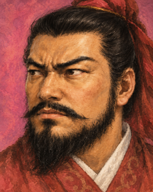</a> | 劉備 | [玄德](https://zh.wikisource.org/w/index.php?title=%E4%B8%89%E5%9C%8B%E5%BF%97/%E5%8D%B732&oldid=2583378) | 85 | 73 | 87 | 100 | 強力 | 000 | F005 |
| <a href="../hd-assets/F002.png">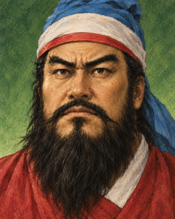</a> | 關羽 | [雲長](https://zh.wikisource.org/w/index.php?title=%E4%B8%89%E5%9C%8B%E5%BF%97/%E5%8D%B736&oldid=2583383) | 99 | 99 | 83 | 90 | 強力 | 001 | F002 |
| <a href="../hd-assets/F012.png">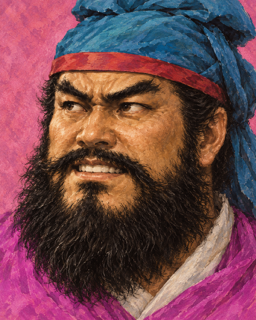</a> | 張飛 | [益德](https://zh.wikisource.org/w/index.php?title=%E4%B8%89%E5%9C%8B%E5%BF%97/%E5%8D%B736&oldid=2583383) 史書作益德；演義作翼德 | 100 | 99 | 41 | 28 | 強力 | 002 | F012 |
| <a href="../hd-assets/F013.png">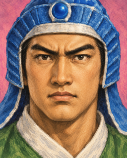</a> | 趙雲 | [子龍](https://zh.wikisource.org/w/index.php?title=%E4%B8%89%E5%9C%8B%E5%BF%97/%E5%8D%B736&oldid=2583383) | 98 | 99 | 88 | 82 | 強力 | 003 | F013 |
| <a href="../hd-assets/F255.png">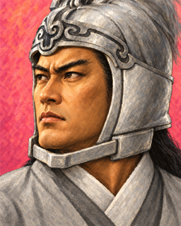</a> | 馬超 | [孟起](https://zh.wikisource.org/w/index.php?title=%E4%B8%89%E5%9C%8B%E5%BF%97/%E5%8D%B736&oldid=2583383) | 99 | 98 | 51 | 84 | 強力 | 004 | F255 |
| <a href="../hd-assets/F062.png">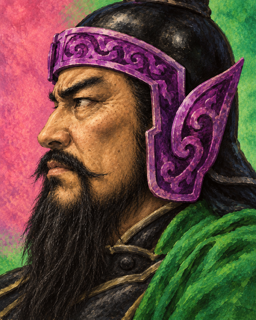</a> | 黃忠 | [漢升](https://zh.wikisource.org/w/index.php?title=%E4%B8%89%E5%9C%8B%E5%BF%97/%E5%8D%B736&oldid=2583383) | 94 | 96 | 68 | 80 | 強力 | 005 | F062 |
| <a href="../hd-assets/F004.png">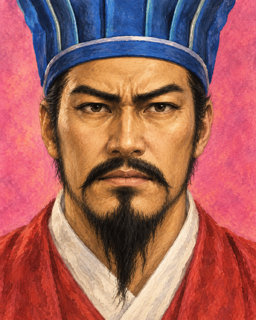</a> | 諸葛亮 | [孔明](https://zh.wikisource.org/w/index.php?title=%E4%B8%89%E5%9C%8B%E5%BF%97/%E5%8D%B735&oldid=2115776) | 73 | 72 | 100 | 98 | 強力 | 006 | F004 |
| <a href="../hd-assets/F007.png">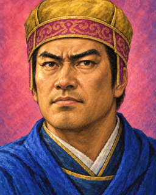</a> | 龐統 | [士元](https://zh.wikisource.org/w/index.php?title=%E4%B8%89%E5%9C%8B%E5%BF%97/%E5%8D%B737&oldid=2583384) | 75 | 76 | 99 | 83 | 強力 | 007 | F007 |
| <a href="../hd-assets/F061.png">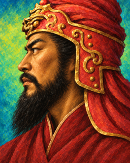</a> | 魏延 | [文長](https://zh.wikisource.org/w/index.php?title=%E4%B8%89%E5%9C%8B%E5%BF%97/%E5%8D%B740&oldid=2583390) | 92 | 94 | 65 | 69 | 強力 | 008 | F061 |
| <a href="../hd-assets/F030.png">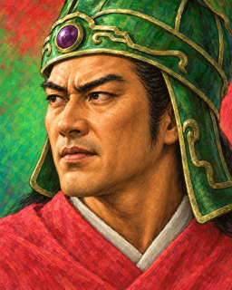</a> | 馬岱 | 待考 | 90 | 87 | 68 | 66 | 山陸 | 009 | F030 |
| <a href="../hd-assets/F198.png">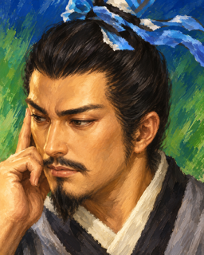</a> | 法正 | [孝直](https://zh.wikisource.org/w/index.php?title=%E4%B8%89%E5%9C%8B%E5%BF%97/%E5%8D%B737&oldid=2583384) | 68 | 54 | 91 | 78 | 山陸 | 010 | F198 |
| <a href="../hd-assets/F036.png">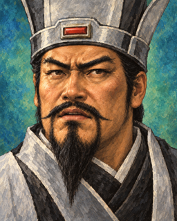</a> | 孟達 | [子度](https://zh.wikipedia.org/w/index.php?title=%E4%B8%89%E5%9B%BD%E6%BC%94%E4%B9%89%E8%A7%92%E8%89%B2%E5%88%97%E8%A1%A8&oldid=89454572)（二手） 初字子敬，後改子度 | 82 | 64 | 77 | 68 | 山陸 | 011 | F036 |
| <a href="../hd-assets/F142.png">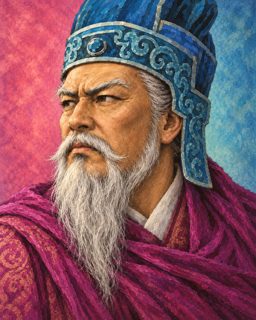</a> | 劉焉 | [君郎](https://zh.wikisource.org/w/index.php?title=%E4%B8%89%E5%9C%8B%E5%BF%97/%E5%8D%B731&oldid=2471750) | 57 | 32 | 84 | 95 | 強力 | 012 | F142 |
| <a href="../hd-assets/F000.png">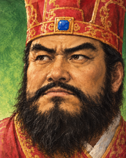</a> | 曹操 | [孟德](https://zh.wikisource.org/w/index.php?title=%E4%B8%89%E5%9C%8B%E5%BF%97/%E5%8D%B701&oldid=2585429) | 90 | 82 | 95 | 99 | 強力 | 013 | F000 |
| <a href="../hd-assets/F077.png">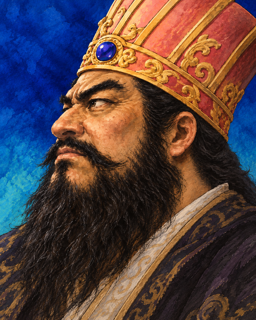</a> | 董卓 | [仲穎](https://zh.wikisource.org/w/index.php?title=%E4%B8%89%E5%9C%8B%E5%BF%97/%E5%8D%B706&oldid=2132349) | 93 | 90 | 55 | 24 | 強力 | 014 | F077 |
| <a href="../hd-assets/F041.png">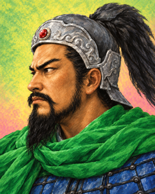</a> | 孫堅 | [文臺](https://zh.wikisource.org/w/index.php?title=%E4%B8%89%E5%9C%8B%E5%BF%97/%E5%8D%B746&oldid=2629010) | 82 | 89 | 84 | 94 | 強力 | 015 | F041 |
| <a href="../hd-assets/F053.png">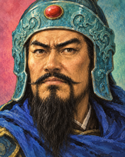</a> | 袁紹 | [本初](https://zh.wikisource.org/w/index.php?title=%E4%B8%89%E5%9C%8B%E5%BF%97/%E5%8D%B706&oldid=2132349) | 80 | 86 | 80 | 90 | 強力 | 016 | F053 |
| <a href="../hd-assets/F097.png">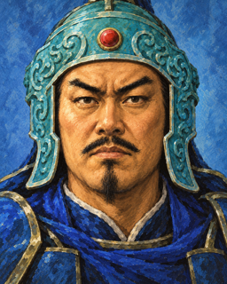</a> | 李傕 | [稚然](https://zh.wikipedia.org/w/index.php?title=%E4%B8%89%E5%9B%BD%E6%BC%94%E4%B9%89%E8%A7%92%E8%89%B2%E5%88%97%E8%A1%A8&oldid=89454572)（二手） | 83 | 68 | 43 | 26 | 山陸 | 017 | F097 |
| <a href="../hd-assets/F096.png">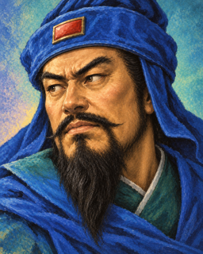</a> | 郭汜 | 待考 | 82 | 69 | 42 | 25 | 山陸 | 018 | F096 |
| <a href="../hd-assets/F185.png">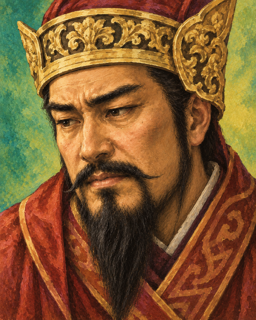</a> | 張濟 | 待考 | 85 | 65 | 60 | 66 | 山陸 | 019 | F185 |
| <a href="../hd-assets/F179.png">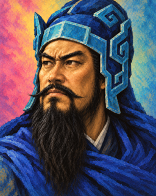</a> | 樊稠 | 待考 | 89 | 72 | 28 | 44 | 山陸 | 020 | F179 |
| <a href="../hd-assets/F076.png">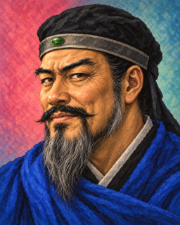</a> | 李儒 | [文優](https://zh.wikipedia.org/w/index.php?title=%E4%B8%89%E5%9B%BD%E6%BC%94%E4%B9%89%E8%A7%92%E8%89%B2%E5%88%97%E8%A1%A8&oldid=89454572)（二手） | 51 | 20 | 91 | 33 | 山陸 | 021 | F076 |
| <a href="../hd-assets/F054.png">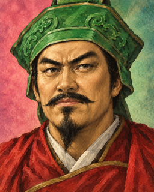</a> | 袁術 | [公路](https://zh.wikisource.org/w/index.php?title=%E4%B8%89%E5%9C%8B%E5%BF%97/%E5%8D%B706&oldid=2132349) | 81 | 80 | 64 | 62 | 強力 | 022 | F054 |
| <a href="../hd-assets/F006.png">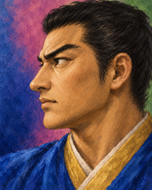</a> | 呂布 | [奉先](https://zh.wikisource.org/w/index.php?title=%E4%B8%89%E5%9C%8B%E5%BF%97/%E5%8D%B707&oldid=2452141) | 97 | 100 | 28 | 45 | 強力 | 023 | F006 |
| <a href="../hd-assets/F032.png">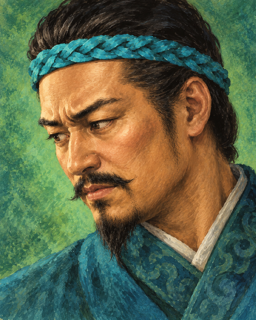</a> | 李肅 | 待考 | 71 | 38 | 54 | 60 | 陸 | 024 | F032 |
| <a href="../hd-assets/F134.png">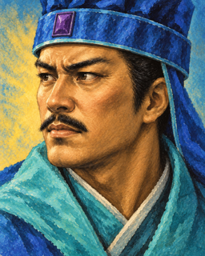</a> | 董旻 | [叔穎](https://zh.wikipedia.org/zh-tw/%E8%91%A3%E6%97%BB)（二手） | 87 | 31 | 34 | 64 | 陸 | 025 | F134 |
| <a href="../hd-assets/F112.png">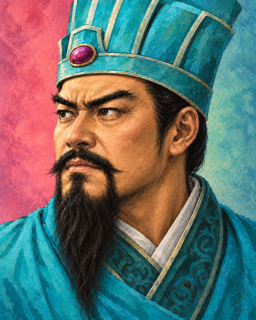</a> | 陳宮 | [公臺](https://zh.wikisource.org/w/index.php?title=%E4%B8%89%E5%9C%8B%E5%BF%97/%E5%8D%B707&oldid=2452141) | 52 | 28 | 89 | 56 | 山陸 | 026 | F112 |
| <a href="../hd-assets/F125.png">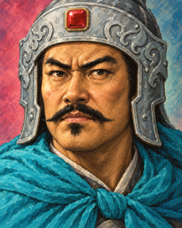</a> | 樂進 | [文謙](https://zh.wikisource.org/w/index.php?title=%E4%B8%89%E5%9C%8B%E5%BF%97/%E5%8D%B717&oldid=2390639) | 79 | 76 | 33 | 40 | 山陸 | 027 | F125 |
|  | 李典 | [曼成](https://zh.wikisource.org/w/index.php?title=%E4%B8%89%E5%9C%8B%E5%BF%97/%E5%8D%B718&oldid=2579680) | 87 | 80 | 61 | 51 | 山陸 | 028 | F248 |
| <a href="../hd-assets/F184.png">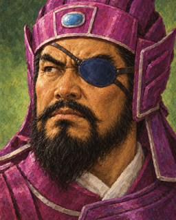</a> | 夏侯惇 | [元讓](https://zh.wikisource.org/w/index.php?title=%E4%B8%89%E5%9C%8B%E5%BF%97/%E5%8D%B709&oldid=2274283) | 94 | 94 | 70 | 79 | 強力 | 029 | F184 |
| <a href="../hd-assets/F155.png">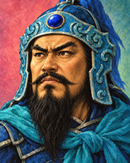</a> | 夏侯淵 | [妙才](https://zh.wikisource.org/w/index.php?title=%E4%B8%89%E5%9C%8B%E5%BF%97/%E5%8D%B709&oldid=2274283) | 92 | 93 | 67 | 74 | 強力 | 030 | F155 |
| <a href="../hd-assets/F131.png">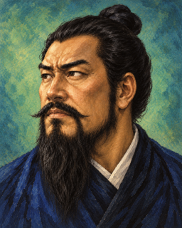</a> | 張邈 | [孟卓](https://zh.wikisource.org/w/index.php?title=%E4%B8%89%E5%9C%8B%E5%BF%97/%E5%8D%B707&oldid=2452141) | 82 | 34 | 45 | 74 | 陸 | 031 | F131 |
| <a href="../hd-assets/F117.png">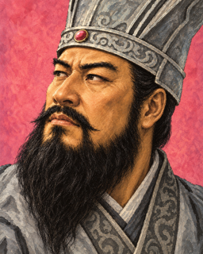</a> | 孔融 | [文舉](https://zh.wikisource.org/w/index.php?title=%E4%B8%89%E5%9C%8B%E5%BF%97/%E5%8D%B712&oldid=2085067) | 84 | 37 | 81 | 82 | 強力 | 032 | F117 |
| <a href="../hd-assets/F114.png">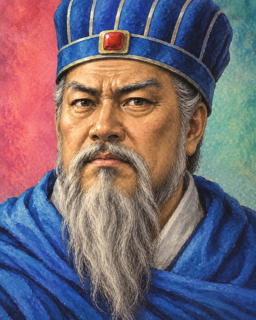</a> | 陶謙 | [恭祖](https://zh.wikisource.org/w/index.php?title=%E4%B8%89%E5%9C%8B%E5%BF%97/%E5%8D%B708&oldid=2086403) | 28 | 15 | 76 | 80 | 強力 | 033 | F114 |
| <a href="../hd-assets/F192.png">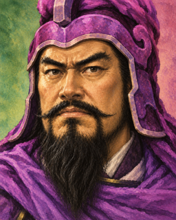</a> | 馬騰 | [壽成](https://zh.wikipedia.org/w/index.php?title=%E4%B8%89%E5%9B%BD%E6%BC%94%E4%B9%89%E8%A7%92%E8%89%B2%E5%88%97%E8%A1%A8&oldid=89454572)（二手） | 95 | 87 | 38 | 81 | 強力 | 034 | F192 |
| <a href="../hd-assets/F063.png">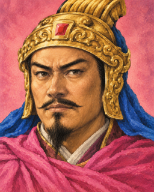</a> | 公孫瓚 | [伯珪](https://zh.wikisource.org/w/index.php?title=%E4%B8%89%E5%9C%8B%E5%BF%97/%E5%8D%B708&oldid=2086403) | 83 | 75 | 67 | 62 | 強力 | 035 | F063 |
| <a href="../hd-assets/F052.png">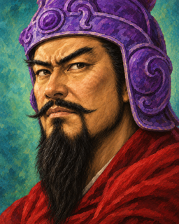</a> | 華雄 | 待考 | 90 | 94 | 17 | 69 | 強力 | 036 | F052 |
| <a href="../hd-assets/F241.png">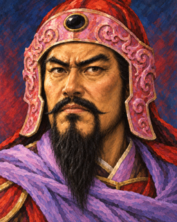</a> | 程普 | [德謀](https://zh.wikisource.org/w/index.php?title=%E4%B8%89%E5%9C%8B%E5%BF%97/%E5%8D%B755&oldid=2603286) | 74 | 78 | 88 | 76 | 強力 | 037 | F241 |
| <a href="../hd-assets/F094.png">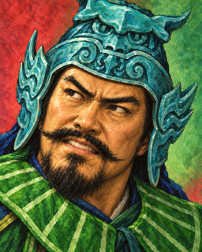</a> | 韓當 | [義公](https://zh.wikisource.org/w/index.php?title=%E4%B8%89%E5%9C%8B%E5%BF%97/%E5%8D%B755&oldid=2603286) | 82 | 74 | 37 | 59 | 水陸 | 038 | F094 |
| <a href="../hd-assets/F055.png">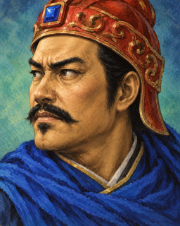</a> | 黃蓋 | [公覆](https://zh.wikisource.org/w/index.php?title=%E4%B8%89%E5%9C%8B%E5%BF%97/%E5%8D%B755&oldid=2603286) | 92 | 88 | 70 | 73 | 強力 | 039 | F055 |
| <a href="../hd-assets/F244.png">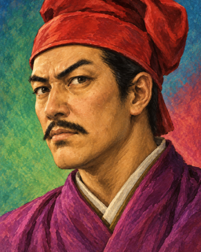</a> | 祖茂 | [大榮](https://zh.wikipedia.org/w/index.php?title=%E4%B8%89%E5%9B%BD%E6%BC%94%E4%B9%89%E8%A7%92%E8%89%B2%E5%88%97%E8%A1%A8&oldid=89454572)（二手） | 84 | 63 | 16 | 60 | 水陸 | 040 | F244 |
| <a href="../hd-assets/F047.png">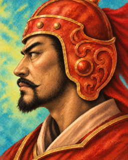</a> | 顏良 | 待考 | 95 | 91 | 36 | 48 | 強力 | 041 | F047 |
| <a href="../hd-assets/F102.png">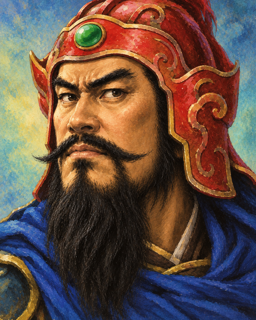</a> | 文醜 | 待考 | 96 | 94 | 35 | 57 | 強力 | 042 | F102 |
| <a href="../hd-assets/F116.png">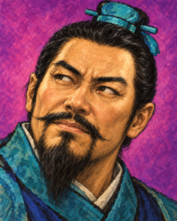</a> | 徐榮 | 待考 | 78 | 28 | 79 | 62 | 陸 | 043 | F116 |
| <a href="../hd-assets/F081.png">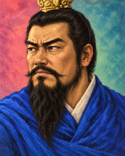</a> | 劉表 | [景升](https://zh.wikisource.org/w/index.php?title=%E4%B8%89%E5%9C%8B%E5%BF%97/%E5%8D%B706&oldid=2132349) | 43 | 54 | 85 | 92 | 強力 | 044 | F081 |
| <a href="../hd-assets/F091.png">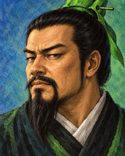</a> | 蒯良 | [子柔](https://zh.wikipedia.org/w/index.php?title=%E4%B8%89%E5%9B%BD%E6%BC%94%E4%B9%89%E8%A7%92%E8%89%B2%E5%88%97%E8%A1%A8&oldid=89454572)（二手） | 62 | 22 | 89 | 71 | 水陸 | 045 | F091 |
| <a href="../hd-assets/F092.png">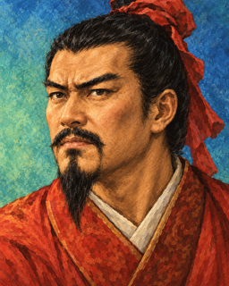</a> | 蒯越 | [異度](https://zh.wikipedia.org/w/index.php?title=%E4%B8%89%E5%9B%BD%E6%BC%94%E4%B9%89%E8%A7%92%E8%89%B2%E5%88%97%E8%A1%A8&oldid=89454572)（二手） | 64 | 20 | 88 | 77 | 水陸 | 046 | F092 |
| <a href="../hd-assets/F246.png">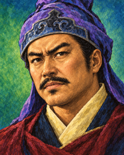</a> | 蔡瑁 | [德珪](https://zh.wikipedia.org/w/index.php?title=%E4%B8%89%E5%9B%BD%E6%BC%94%E4%B9%89%E8%A7%92%E8%89%B2%E5%88%97%E8%A1%A8&oldid=89454572)（二手） | 87 | 78 | 65 | 61 | 水陸 | 047 | F246 |
| <a href="../hd-assets/F111.png">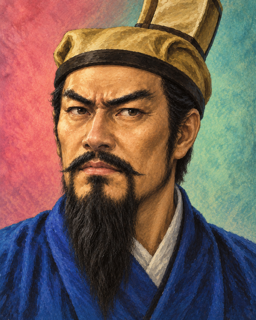</a> | 逢紀 | [元圖](https://zh.wikipedia.org/w/index.php?title=%E4%B8%89%E5%9B%BD%E6%BC%94%E4%B9%89%E8%A7%92%E8%89%B2%E5%88%97%E8%A1%A8&oldid=89454572)（二手） | 74 | 31 | 85 | 54 | 陸 | 048 | F111 |
| <a href="../hd-assets/F093.png">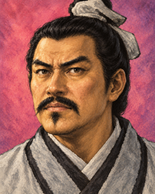</a> | 荀諶 | [友若](https://zh.wikipedia.org/w/index.php?title=%E4%B8%89%E5%9B%BD%E6%BC%94%E4%B9%89%E8%A7%92%E8%89%B2%E5%88%97%E8%A1%A8&oldid=89454572)（二手） | 76 | 24 | 75 | 60 | 陸 | 049 | F093 |
| <a href="../hd-assets/F080.png">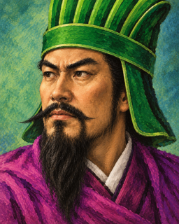</a> | 辛評 | [仲治](https://zh.wikipedia.org/w/index.php?title=%E4%B8%89%E5%9B%BD%E6%BC%94%E4%B9%89%E8%A7%92%E8%89%B2%E5%88%97%E8%A1%A8&oldid=89454572)（二手） | 75 | 29 | 82 | 43 | 陸 | 050 | F080 |
|  | 田豐 | [元皓](https://zh.wikipedia.org/w/index.php?title=%E4%B8%89%E5%9B%BD%E6%BC%94%E4%B9%89%E8%A7%92%E8%89%B2%E5%88%97%E8%A1%A8&oldid=89454572)（二手） | 64 | 70 | 93 | 70 | 強力 | 051 | F249 |
|  | 沮授 | [公與](https://zh.wikipedia.org/w/index.php?title=%E4%B8%89%E5%9B%BD%E6%BC%94%E4%B9%89%E8%A7%92%E8%89%B2%E5%88%97%E8%A1%A8&oldid=89454572)（二手） | 75 | 40 | 86 | 56 | 陸 | 052 | F113 |
|  | 許攸 | [子遠](https://zh.wikipedia.org/w/index.php?title=%E4%B8%89%E5%9B%BD%E6%BC%94%E4%B9%89%E8%A7%92%E8%89%B2%E5%88%97%E8%A1%A8&oldid=89454572)（二手） | 71 | 32 | 87 | 67 | 山陸 | 053 | F168 |
|  | 公孫越 | 待考 | 80 | 40 | 43 | 34 | 陸 | 054 | F199 |
|  | 孫策 | [伯符](https://zh.wikisource.org/w/index.php?title=%E4%B8%89%E5%9C%8B%E5%BF%97/%E5%8D%B746&oldid=2629010) | 92 | 93 | 88 | 91 | 強力 | 055 | F164 |
|  | 孫權 | [仲謀](https://zh.wikisource.org/w/index.php?title=%E4%B8%89%E5%9C%8B%E5%BF%97/%E5%8D%B747&oldid=2602668) | 93 | 80 | 80 | 99 | 水陸 | 056 | F008 |
|  | 孫翊 | [叔弼](https://zh.wikisource.org/w/index.php?title=%E4%B8%89%E5%9C%8B%E5%BF%97/%E5%8D%B751&oldid=2457446) | 76 | 57 | 23 | 54 | 水陸 | 057 | F110 |
|  | 孫匡 | [季佐](https://zh.wikisource.org/w/index.php?title=%E4%B8%89%E5%9C%8B%E5%BF%97/%E5%8D%B751&oldid=2457446) | 80 | 45 | 34 | 65 | 水陸 | 058 | F150 |
|  | 黃祖 | 待考 | 79 | 50 | 43 | 46 | 水陸 | 059 | F169 |
|  | 陳生 | 待考 | 80 | 66 | 13 | 29 | 水陸 | 060 | F243 |
|  | 呂公 | 待考 | 89 | 61 | 43 | 23 | 水陸 | 061 | F240 |
|  | 董璜 | 待考 | 64 | 39 | 24 | 54 | 陸 | 062 | F170 |
|  | 賈詡 | [文和](https://zh.wikisource.org/w/index.php?title=%E4%B8%89%E5%9C%8B%E5%BF%97/%E5%8D%B710&oldid=2274279) | 55 | 46 | 95 | 76 | 山陸 | 063 | F160 |
|  | 韓遂 | [文約](https://zh.wikipedia.org/w/index.php?title=%E4%B8%89%E5%9B%BD%E6%BC%94%E4%B9%89%E8%A7%92%E8%89%B2%E5%88%97%E8%A1%A8&oldid=89454572)（二手） | 71 | 72 | 47 | 54 | 山陸 | 064 | F188 |
|  | 荀彧 | [文若](https://zh.wikisource.org/w/index.php?title=%E4%B8%89%E5%9C%8B%E5%BF%97/%E5%8D%B710&oldid=2274279) | 73 | 49 | 97 | 78 | 強力 | 065 | F172 |
|  | 荀攸 | [公達](https://zh.wikisource.org/w/index.php?title=%E4%B8%89%E5%9C%8B%E5%BF%97/%E5%8D%B710&oldid=2274279) | 66 | 45 | 92 | 75 | 山陸 | 066 | F215 |
|  | 程昱 | [仲德](https://zh.wikisource.org/w/index.php?title=%E4%B8%89%E5%9C%8B%E5%BF%97/%E5%8D%B714&oldid=2374427) | 57 | 46 | 92 | 76 | 強力 | 067 | F176 |
|  | 郭嘉 | [奉孝](https://zh.wikisource.org/w/index.php?title=%E4%B8%89%E5%9C%8B%E5%BF%97/%E5%8D%B714&oldid=2374427) | 52 | 65 | 97 | 83 | 強力 | 068 | F143 |
|  | 劉曄 | [子揚](https://zh.wikisource.org/w/index.php?title=%E4%B8%89%E5%9C%8B%E5%BF%97/%E5%8D%B714&oldid=2374427) 史書作子揚；演義作子陽 | 75 | 54 | 88 | 74 | 強力 | 069 | F180 |
|  | 滿寵 | [伯寧](https://zh.wikisource.org/w/index.php?title=%E4%B8%89%E5%9C%8B%E5%BF%97/%E5%8D%B726&oldid=2085108) | 74 | 41 | 63 | 75 | 陸 | 070 | F162 |
|  | 呂虔 | [子恪](https://zh.wikisource.org/w/index.php?title=%E4%B8%89%E5%9C%8B%E5%BF%97/%E5%8D%B718&oldid=2579680) | 87 | 53 | 60 | 45 | 山陸 | 071 | F196 |
|  | 于禁 | [文則](https://zh.wikisource.org/w/index.php?title=%E4%B8%89%E5%9C%8B%E5%BF%97/%E5%8D%B717&oldid=2390639) | 82 | 70 | 60 | 35 | 山陸 | 072 | F049 |
|  | 毛玠 | [孝先](https://zh.wikisource.org/w/index.php?title=%E4%B8%89%E5%9C%8B%E5%BF%97/%E5%8D%B712&oldid=2085067) | 82 | 64 | 43 | 24 | 水陸 | 073 | F058 |
|  | 典韋 | 待考 | 95 | 97 | 28 | 56 | 強力 | 074 | F146 |
|  | 麋竺 | [子仲](https://zh.wikisource.org/w/index.php?title=%E4%B8%89%E5%9C%8B%E5%BF%97/%E5%8D%B738&oldid=8737777) | 80 | 23 | 77 | 74 | 陸 | 075 | F173 |
|  | 陳登 | [元龍](https://zh.wikipedia.org/w/index.php?title=%E4%B8%89%E5%9B%BD%E6%BC%94%E4%B9%89%E8%A7%92%E8%89%B2%E5%88%97%E8%A1%A8&oldid=89454572)（二手） | 65 | 60 | 86 | 79 | 水陸 | 076 | F181 |
|  | 太史慈 | [子義](https://zh.wikisource.org/w/index.php?title=%E4%B8%89%E5%9C%8B%E5%BF%97/%E5%8D%B749&oldid=2075209) | 91 | 94 | 40 | 68 | 強力 | 077 | F021 |
|  | 劉繇 | [正禮](https://zh.wikisource.org/w/index.php?title=%E4%B8%89%E5%9C%8B%E5%BF%97/%E5%8D%B749&oldid=2075209) | 70 | 20 | 55 | 35 | 強力 | 078 | F166 |
|  | 張遼 | [文遠](https://zh.wikisource.org/w/index.php?title=%E4%B8%89%E5%9C%8B%E5%BF%97/%E5%8D%B717&oldid=2390639) | 95 | 94 | 88 | 73 | 強力 | 079 | F101 |
|  | 臧霸 | [宣高](https://zh.wikisource.org/w/index.php?title=%E4%B8%89%E5%9C%8B%E5%BF%97/%E5%8D%B718&oldid=2579680) | 88 | 78 | 19 | 42 | 山陸 | 080 | F057 |
|  | 郝萌 | 待考 | 71 | 73 | 30 | 46 | 山陸 | 081 | F238 |
|  | 曹性 | 待考 | 72 | 65 | 53 | 31 | 山陸 | 082 | F073 |
|  | 成廉 | 待考 | 74 | 75 | 24 | 26 | 山陸 | 083 | F234 |
|  | 魏續 | 待考 | 80 | 76 | 19 | 40 | 山陸 | 084 | F228 |
|  | 宋憲 | 待考 | 78 | 73 | 35 | 57 | 山陸 | 085 | F099 |
|  | 侯成 | 待考 | 89 | 78 | 37 | 51 | 山陸 | 086 | F085 |
|  | 孫乾 | [公佑](https://zh.wikisource.org/w/index.php?title=%E4%B8%89%E5%9C%8B%E5%BF%97/%E5%8D%B738&oldid=8737777) | 72 | 24 | 79 | 78 | 陸 | 087 | F186 |
|  | 許褚 | [仲康](https://zh.wikisource.org/w/index.php?title=%E4%B8%89%E5%9C%8B%E5%BF%97/%E5%8D%B718&oldid=2579680) | 99 | 98 | 26 | 53 | 強力 | 088 | F156 |
|  | 審配 | [正南](https://zh.wikipedia.org/zh-tw/%E5%AF%A9%E9%85%8D)（二手） | 65 | 60 | 89 | 78 | 山陸 | 089 | F178 |
|  | 楊奉 | 待考 | 76 | 50 | 56 | 61 | 山陸 | 090 | F128 |
|  | 徐晃 | [公明](https://zh.wikisource.org/w/index.php?title=%E4%B8%89%E5%9C%8B%E5%BF%97/%E5%8D%B717&oldid=2390639) | 90 | 91 | 61 | 66 | 強力 | 091 | F029 |
|  | 董昭 | [公仁](https://zh.wikisource.org/w/index.php?title=%E4%B8%89%E5%9C%8B%E5%BF%97/%E5%8D%B714&oldid=2374427) | 72 | 24 | 81 | 53 | 陸 | 092 | F181 |
|  | 紀靈 | 待考 | 82 | 78 | 31 | 59 | 山陸 | 093 | F165 |
|  | 朱治 | [君理](https://zh.wikisource.org/w/index.php?title=%E4%B8%89%E5%9C%8B%E5%BF%97/%E5%8D%B756&oldid=2627183) | 74 | 40 | 48 | 36 | 水陸 | 094 | F189 |
|  | 呂範 | [子衡](https://zh.wikisource.org/w/index.php?title=%E4%B8%89%E5%9C%8B%E5%BF%97/%E5%8D%B756&oldid=2627183) | 71 | 31 | 76 | 64 | 水陸 | 095 | F177 |
|  | 周瑜 | [公瑾](https://zh.wikisource.org/w/index.php?title=%E4%B8%89%E5%9C%8B%E5%BF%97/%E5%8D%B754&oldid=2387393) | 83 | 84 | 97 | 94 | 強力 | 096 | F014 |
|  | 張昭 | [子布](https://zh.wikisource.org/w/index.php?title=%E4%B8%89%E5%9C%8B%E5%BF%97/%E5%8D%B752&oldid=2085149) | 63 | 38 | 96 | 82 | 水陸 | 097 | F144 |
|  | 張紘 | [子綱](https://zh.wikisource.org/w/index.php?title=%E4%B8%89%E5%9C%8B%E5%BF%97/%E5%8D%B753&oldid=2086397) | 45 | 58 | 93 | 83 | 水陸 | 098 | F216 |
|  | 蔣欽 | [公弈](https://zh.wikisource.org/w/index.php?title=%E4%B8%89%E5%9C%8B%E5%BF%97/%E5%8D%B755&oldid=2603286) | 89 | 73 | 29 | 31 | 水陸 | 099 | F084 |
|  | 周泰 | [幼平](https://zh.wikisource.org/w/index.php?title=%E4%B8%89%E5%9C%8B%E5%BF%97/%E5%8D%B755&oldid=2603286) | 90 | 87 | 22 | 60 | 強力 | 100 | F031 |
|  | 陳武 | [子烈](https://zh.wikisource.org/w/index.php?title=%E4%B8%89%E5%9C%8B%E5%BF%97/%E5%8D%B755&oldid=2603286) | 85 | 70 | 32 | 23 | 水陸 | 101 | F226 |
|  | 凌操 | 待考 | 80 | 58 | 43 | 34 | 水陸 | 102 | F204 |
|  | 王朗 | [景興](https://zh.wikisource.org/w/index.php?title=%E4%B8%89%E5%9C%8B%E5%BF%97/%E5%8D%B713&oldid=2331498) | 65 | 12 | 82 | 74 | 強力 | 103 | F209 |
|  | 虞翻 | [仲翔](https://zh.wikisource.org/w/index.php?title=%E4%B8%89%E5%9C%8B%E5%BF%97/%E5%8D%B757&oldid=2638131) | 74 | 32 | 84 | 82 | 水陸 | 104 | F213 |
|  | 董襲 | [元代](https://zh.wikisource.org/w/index.php?title=%E4%B8%89%E5%9C%8B%E5%BF%97/%E5%8D%B755&oldid=2603286) | 74 | 65 | 33 | 24 | 水陸 | 105 | F195 |
|  | 張勳 | 待考 | 82 | 50 | 13 | 40 | 山陸 | 106 | F191 |
|  | 雷薄 | 待考 | 76 | 65 | 32 | 30 | 山陸 | 107 | F188 |
|  | 陳蘭 | 待考 | 72 | 67 | 25 | 34 | 山陸 | 108 | F185 |
|  | 橋蕤 | 待考 | 82 | 80 | 26 | 45 | 山陸 | 109 | F069 |
|  | 陳珪 | [漢瑜](https://zh.wikipedia.org/w/index.php?title=%E4%B8%89%E5%9B%BD%E6%BC%94%E4%B9%89%E8%A7%92%E8%89%B2%E5%88%97%E8%A1%A8&oldid=89454572)（二手） | 38 | 12 | 89 | 68 | 陸 | 110 | F236 |
|  | 張繡 | 待考 | 81 | 51 | 80 | 80 | 山陸 | 111 | F147 |
|  | 曹純 | [子和](https://zh.wikipedia.org/w/index.php?title=%E4%B8%89%E5%9B%BD%E6%BC%94%E4%B9%89%E8%A7%92%E8%89%B2%E5%88%97%E8%A1%A8&oldid=89454572)（二手） | 76 | 51 | 25 | 36 | 山陸 | 112 | F190 |
|  | 簡雍 | [憲和](https://zh.wikisource.org/w/index.php?title=%E4%B8%89%E5%9C%8B%E5%BF%97/%E5%8D%B738&oldid=8737777) | 70 | 20 | 82 | 68 | 陸 | 113 | F154 |
|  | 劉璋 | [季玉](https://zh.wikisource.org/w/index.php?title=%E4%B8%89%E5%9C%8B%E5%BF%97/%E5%8D%B731&oldid=2471750) | 71 | 64 | 63 | 94 | 山陸 | 114 | F237 |
|  | 張魯 | [公祺](https://zh.wikisource.org/w/index.php?title=%E4%B8%89%E5%9C%8B%E5%BF%97/%E5%8D%B708&oldid=2086403) | 74 | 73 | 80 | 88 | 山陸 | 115 | F227 |
|  | 郭圖 | [公則](https://zh.wikipedia.org/w/index.php?title=%E4%B8%89%E5%9B%BD%E6%BC%94%E4%B9%89%E8%A7%92%E8%89%B2%E5%88%97%E8%A1%A8&oldid=89454572)（二手） | 78 | 34 | 86 | 78 | 陸 | 116 | F129 |
|  | 陳琳 | [孔璋](https://zh.wikipedia.org/w/index.php?title=%E4%B8%89%E5%9B%BD%E6%BC%94%E4%B9%89%E8%A7%92%E8%89%B2%E5%88%97%E8%A1%A8&oldid=89454572)（二手） | 65 | 13 | 72 | 69 | 陸 | 117 | F148 |
|  | 高覽 | 待考 | 80 | 68 | 26 | 34 | 山陸 | 118 | F179 |
|  | 張郃 | [雋乂](https://zh.wikisource.org/w/index.php?title=%E4%B8%89%E5%9C%8B%E5%BF%97/%E5%8D%B717&oldid=2390639) | 94 | 94 | 71 | 43 | 強力 | 119 | F233 |
|  | 麋芳 | [子方](https://zh.wikipedia.org/zh-tw/%E9%BA%8B%E8%8A%B3)（二手） | 81 | 70 | 46 | 31 | 山陸 | 120 | F103 |
|  | 蔡陽 | 待考 | 72 | 75 | 34 | 30 | 山陸 | 121 | F171 |
|  | 廖化 | [元儉](https://zh.wikisource.org/w/index.php?title=%E4%B8%89%E5%9C%8B%E5%BF%97/%E5%8D%B745&oldid=2085136) | 85 | 77 | 54 | 40 | 山陸 | 122 | F243 |
|  | 周倉 | [元福](https://zh.wikipedia.org/zh-tw/%E5%91%A8%E5%80%89)（二手） | 91 | 88 | 28 | 31 | 山陸 | 123 | F039 |
|  | 關平 | 待考 | 87 | 81 | 62 | 69 | 山陸 | 124 | F252 |
|  | 華歆 | [子魚](https://zh.wikisource.org/w/index.php?title=%E4%B8%89%E5%9C%8B%E5%BF%97/%E5%8D%B713&oldid=2331498) | 65 | 23 | 83 | 79 | 陸 | 125 | F118 |
|  | 魯肅 | [子敬](https://zh.wikisource.org/w/index.php?title=%E4%B8%89%E5%9C%8B%E5%BF%97/%E5%8D%B754&oldid=2387393) | 80 | 68 | 95 | 89 | 強力 | 126 | F132 |
|  | 諸葛瑾 | [子瑜](https://zh.wikisource.org/w/index.php?title=%E4%B8%89%E5%9C%8B%E5%BF%97/%E5%8D%B752&oldid=2085149) | 72 | 43 | 90 | 61 | 強力 | 127 | F159 |
|  | 顧雍 | [元歎](https://zh.wikisource.org/w/index.php?title=%E4%B8%89%E5%9C%8B%E5%BF%97/%E5%8D%B752&oldid=2085149) | 63 | 24 | 81 | 72 | 水陸 | 128 | F153 |
|  | 袁譚 | [顯思](https://zh.wikipedia.org/zh-tw/%E8%A2%81%E8%AD%9A)（二手） | 76 | 71 | 63 | 86 | 山陸 | 129 | F126 |
|  | 袁熙 | [顯奕](https://zh.wikipedia.org/zh-tw/%E8%A2%81%E7%86%99)（二手） | 73 | 46 | 32 | 80 | 陸 | 130 | F089 |
|  | 袁尚 | [顯甫](https://zh.wikipedia.org/zh-tw/%E8%A2%81%E5%B0%9A)（二手） | 82 | 85 | 55 | 89 | 山陸 | 131 | F022 |
|  | 呂曠 | 待考 | 79 | 78 | 36 | 24 | 山陸 | 132 | F190 |
|  | 辛毗 | [佐治](https://zh.wikisource.org/w/index.php?title=%E4%B8%89%E5%9C%8B%E5%BF%97/%E5%8D%B725&oldid=2074129) | 65 | 34 | 79 | 76 | 山陸 | 133 | F151 |
|  | 呂翔 | 待考 | 74 | 76 | 23 | 28 | 山陸 | 134 | F197 |
|  | 曹丕 | [子桓](https://zh.wikipedia.org/w/index.php?title=%E4%B8%89%E5%9B%BD%E6%BC%94%E4%B9%89%E8%A7%92%E8%89%B2%E5%88%97%E8%A1%A8&oldid=89454572)（二手） | 85 | 85 | 87 | 95 | 強力 | 135 | F229 |
|  | 曹植 | [子建](https://zh.wikisource.org/w/index.php?title=%E4%B8%89%E5%9C%8B%E5%BF%97/%E5%8D%B719&oldid=2347417) | 75 | 22 | 89 | 85 | 山陸 | 136 | F127 |
|  | 伊籍 | [機伯](https://zh.wikisource.org/w/index.php?title=%E4%B8%89%E5%9C%8B%E5%BF%97/%E5%8D%B738&oldid=8737777) | 74 | 36 | 87 | 75 | 山陸 | 137 | F130 |
|  | 劉琦 | 待考 | 84 | 69 | 76 | 85 | 水陸 | 138 | F141 |
|  | 劉琮 | 待考 | 74 | 34 | 77 | 84 | 水陸 | 139 | F122 |
|  | 蔡和 | 待考 | 76 | 43 | 21 | 25 | 水陸 | 140 | F205 |
|  | 蔡中 | 待考 | 76 | 39 | 22 | 20 | 水陸 | 141 | F206 |
|  | 蔡勳 | 待考 | 75 | 36 | 18 | 23 | 水陸 | 142 | F207 |
|  | 文聘 | [仲業](https://zh.wikisource.org/w/index.php?title=%E4%B8%89%E5%9C%8B%E5%BF%97/%E5%8D%B718&oldid=2579680) | 88 | 86 | 51 | 48 | 強力 | 143 | F167 |
|  | 闞澤 | [德潤](https://zh.wikisource.org/w/index.php?title=%E4%B8%89%E5%9C%8B%E5%BF%97/%E5%8D%B753&oldid=2086397) | 58 | 22 | 85 | 80 | 水陸 | 144 | F157 |
|  | 劉封 | 待考 | 85 | 71 | 52 | 63 | 山陸 | 145 | F045 |
|  | 徐庶 | [元直](https://zh.wikipedia.org/w/index.php?title=%E4%B8%89%E5%9B%BD%E6%BC%94%E4%B9%89%E8%A7%92%E8%89%B2%E5%88%97%E8%A1%A8&oldid=89454572)（二手） | 81 | 76 | 95 | 81 | 強力 | 146 | F120 |
|  | 程秉 | [德樞](https://zh.wikisource.org/w/index.php?title=%E4%B8%89%E5%9C%8B%E5%BF%97/%E5%8D%B753&oldid=2086397) | 72 | 22 | 76 | 59 | 水陸 | 147 | F152 |
|  | 朱桓 | [休穆](https://zh.wikisource.org/w/index.php?title=%E4%B8%89%E5%9C%8B%E5%BF%97/%E5%8D%B756&oldid=2627183) | 84 | 82 | 81 | 41 | 水陸 | 148 | F135 |
|  | 張溫 | [惠恕](https://zh.wikisource.org/w/index.php?title=%E4%B8%89%E5%9C%8B%E5%BF%97/%E5%8D%B757&oldid=2638131) | 73 | 20 | 68 | 73 | 水陸 | 149 | F087 |
|  | 凌統 | [公績](https://zh.wikisource.org/w/index.php?title=%E4%B8%89%E5%9C%8B%E5%BF%97/%E5%8D%B755&oldid=2603286) | 85 | 75 | 43 | 31 | 水陸 | 150 | F051 |
|  | 呂蒙 | [子明](https://zh.wikisource.org/w/index.php?title=%E4%B8%89%E5%9C%8B%E5%BF%97/%E5%8D%B754&oldid=2387393) | 79 | 78 | 91 | 63 | 強力 | 151 | F028 |
|  | 陸遜 | [伯言](https://zh.wikisource.org/w/index.php?title=%E4%B8%89%E5%9C%8B%E5%BF%97/%E5%8D%B758&oldid=2131313) | 84 | 80 | 96 | 78 | 強力 | 152 | F254 |
|  | 徐盛 | [文嚮](https://zh.wikisource.org/w/index.php?title=%E4%B8%89%E5%9C%8B%E5%BF%97/%E5%8D%B755&oldid=2603286) | 88 | 74 | 75 | 54 | 強力 | 153 | F234 |
|  | 潘璋 | [文珪](https://zh.wikisource.org/w/index.php?title=%E4%B8%89%E5%9C%8B%E5%BF%97/%E5%8D%B755&oldid=2603286) | 84 | 76 | 29 | 32 | 水陸 | 154 | F174 |
|  | 丁奉 | [承淵](https://zh.wikisource.org/w/index.php?title=%E4%B8%89%E5%9C%8B%E5%BF%97/%E5%8D%B755&oldid=2603286) | 81 | 62 | 79 | 68 | 水陸 | 155 | F100 |
|  | 甘寧 | [興霸](https://zh.wikisource.org/w/index.php?title=%E4%B8%89%E5%9C%8B%E5%BF%97/%E5%8D%B755&oldid=2603286) | 92 | 94 | 67 | 70 | 強力 | 156 | F251 |
|  | 司馬懿 | [仲達](https://zh.wikipedia.org/w/index.php?title=%E4%B8%89%E5%9B%BD%E6%BC%94%E4%B9%89%E8%A7%92%E8%89%B2%E5%88%97%E8%A1%A8&oldid=89454572)（二手） | 88 | 74 | 98 | 91 | 強力 | 157 | F010 |
|  | 傅巽 | [公悌](https://zh.wikipedia.org/w/index.php?title=%E4%B8%89%E5%9B%BD%E6%BC%94%E4%B9%89%E8%A7%92%E8%89%B2%E5%88%97%E8%A1%A8&oldid=89454572)（二手） | 74 | 18 | 74 | 60 | 山陸 | 158 | F075 |
|  | 王粲 | [仲宣](https://zh.wikisource.org/w/index.php?title=%E4%B8%89%E5%9C%8B%E5%BF%97/%E5%8D%B721&oldid=2333888) | 82 | 20 | 85 | 77 | 陸 | 159 | F074 |
|  | 韓玄 | 待考 | 71 | 26 | 34 | 25 | 山陸 | 160 | F046 |
|  | 步騭 | [子山](https://zh.wikipedia.org/zh-tw/%E6%AD%A5%E9%A8%AD)（二手） | 71 | 43 | 75 | 72 | 水陸 | 161 | F175 |
|  | 蔣幹 | [子翼](https://zh.wikipedia.org/w/index.php?title=%E4%B8%89%E5%9B%BD%E6%BC%94%E4%B9%89%E8%A7%92%E8%89%B2%E5%88%97%E8%A1%A8&oldid=89454572)（二手） | 78 | 16 | 70 | 56 | 水陸 | 162 | F067 |
|  | 牛金 | 待考 | 87 | 80 | 21 | 31 | 山陸 | 163 | F033 |
|  | 陳矯 | [季弼](https://zh.wikisource.org/w/index.php?title=%E4%B8%89%E5%9C%8B%E5%BF%97/%E5%8D%B722&oldid=2085105) | 84 | 23 | 86 | 76 | 山陸 | 164 | F202 |
|  | 馬良 | [季常](https://zh.wikisource.org/w/index.php?title=%E4%B8%89%E5%9C%8B%E5%BF%97/%E5%8D%B739&oldid=2583389) | 54 | 39 | 92 | 77 | 強力 | 165 | F214 |
|  | 馬謖 | [幼常](https://zh.wikipedia.org/w/index.php?title=%E4%B8%89%E5%9B%BD%E6%BC%94%E4%B9%89%E8%A7%92%E8%89%B2%E5%88%97%E8%A1%A8&oldid=89454572)（二手） | 88 | 57 | 83 | 78 | 強力 | 166 | F060 |
|  | 劉度 | 待考 | 76 | 18 | 42 | 60 | 山陸 | 167 | F078 |
|  | 劉賢 | 待考 | 72 | 35 | 34 | 54 | 山陸 | 168 | F070 |
|  | 刑道榮 | 待考 | 85 | 87 | 43 | 31 | 山陸 | 169 | F064 |
|  | 趙範 | 待考 | 67 | 42 | 60 | 46 | 山陸 | 170 | F098 |
|  | 陳應 | 待考 | 89 | 73 | 21 | 35 | 水陸 | 171 | F165 |
|  | 鮑龍 | 待考 | 85 | 70 | 23 | 26 | 水陸 | 172 | F177 |
|  | 金旋 | [元機](https://zh.wikisource.org/w/index.php?title=%E4%B8%89%E5%9C%8B%E5%BF%97/%E5%8D%B732&oldid=2583378) | 71 | 44 | 43 | 36 | 山陸 | 173 | F024 |
|  | 鞏志 | 待考 | 68 | 33 | 73 | 70 | 山陸 | 174 | F072 |
|  | 劉磐 | 待考 | 76 | 37 | 60 | 53 | 山陸 | 175 | F196 |
|  | 楊齡 | 待考 | 78 | 71 | 43 | 32 | 山陸 | 176 | F108 |
|  | 宋謙 | 待考 | 80 | 68 | 32 | 24 | 水陸 | 177 | F171 |
|  | 賈華 | 待考 | 83 | 72 | 39 | 36 | 水陸 | 178 | F043 |
|  | 曹休 | [文烈](https://zh.wikisource.org/w/index.php?title=%E4%B8%89%E5%9C%8B%E5%BF%97/%E5%8D%B709&oldid=2274283) | 88 | 64 | 56 | 71 | 山陸 | 179 | F167 |
|  | 鍾繇 | [元常](https://zh.wikisource.org/w/index.php?title=%E4%B8%89%E5%9C%8B%E5%BF%97/%E5%8D%B713&oldid=2331498) | 61 | 21 | 79 | 58 | 山陸 | 180 | F201 |
|  | 馬鐵 | 待考 | 83 | 69 | 24 | 31 | 山陸 | 181 | F194 |
|  | 馬休 | 待考 | 78 | 65 | 26 | 41 | 山陸 | 182 | F195 |
|  | 陳群 | [長文](https://zh.wikipedia.org/w/index.php?title=%E4%B8%89%E5%9B%BD%E6%BC%94%E4%B9%89%E8%A7%92%E8%89%B2%E5%88%97%E8%A1%A8&oldid=89454572)（二手） | 70 | 35 | 94 | 82 | 山陸 | 183 | F068 |
|  | 龐德 | [令明](https://zh.wikisource.org/w/index.php?title=%E4%B8%89%E5%9C%8B%E5%BF%97/%E5%8D%B718&oldid=2579680) | 95 | 95 | 66 | 47 | 強力 | 184 | F138 |
|  | 侯選 | 待考 | 78 | 77 | 43 | 24 | 山陸 | 185 | F185 |
|  | 程銀 | 待考 | 76 | 60 | 53 | 46 | 山陸 | 186 | F191 |
|  | 李堪 | 待考 | 74 | 70 | 56 | 48 | 山陸 | 187 | F162 |
|  | 張橫 | 待考 | 80 | 72 | 31 | 34 | 山陸 | 188 | F161 |
|  | 梁興 | 待考 | 84 | 58 | 21 | 42 | 山陸 | 189 | F197 |
|  | 成宜 | 待考 | 82 | 65 | 35 | 22 | 山陸 | 190 | F166 |
|  | 馬玩 | 待考 | 81 | 61 | 30 | 40 | 山陸 | 191 | F150 |
|  | 楊秋 | 待考 | 72 | 52 | 50 | 21 | 山陸 | 192 | F151 |
|  | 鍾進 | 待考 | 76 | 41 | 43 | 32 | 陸 | 193 | F157 |
|  | 楊阜 | [義山](https://zh.wikisource.org/w/index.php?title=%E4%B8%89%E5%9C%8B%E5%BF%97/%E5%8D%B725&oldid=2074129) | 72 | 23 | 83 | 60 | 陸 | 194 | F159 |
|  | 張衛 | [公則](https://zh.wikipedia.org/zh-tw/%E5%BC%A0%E5%8D%AB)（二手） | 88 | 77 | 38 | 34 | 山陸 | 195 | F096 |
|  | 張松 | [子喬](https://zh.wikipedia.org/w/index.php?title=%E4%B8%89%E5%9B%BD%E6%BC%94%E4%B9%89%E8%A7%92%E8%89%B2%E5%88%97%E8%A1%A8&oldid=89454572)（二手） 史書作子喬；演義作永年 | 73 | 50 | 92 | 42 | 山陸 | 196 | F163 |
|  | 楊修 | [德祖](https://zh.wikipedia.org/w/index.php?title=%E4%B8%89%E5%9B%BD%E6%BC%94%E4%B9%89%E8%A7%92%E8%89%B2%E5%88%97%E8%A1%A8&oldid=89454572)（二手） | 54 | 12 | 91 | 77 | 陸 | 197 | F056 |
|  | 黃權 | [公衡](https://zh.wikisource.org/w/index.php?title=%E4%B8%89%E5%9C%8B%E5%BF%97/%E5%8D%B743&oldid=2085132) | 79 | 70 | 70 | 63 | 山陸 | 198 | F088 |
|  | 李恢 | [德昂](https://zh.wikisource.org/w/index.php?title=%E4%B8%89%E5%9C%8B%E5%BF%97/%E5%8D%B743&oldid=2085132) | 66 | 33 | 90 | 81 | 山陸 | 199 | F071 |
|  | 王累 | 待考 | 63 | 27 | 66 | 42 | 山陸 | 200 | F225 |
|  | 劉貴 | 待考 | 73 | 59 | 46 | 60 | 山陸 | 201 | F073 |
|  | 冷苞 | 待考 | 78 | 78 | 56 | 31 | 山陸 | 202 | F027 |
|  | 張任 | 待考 | 91 | 91 | 79 | 34 | 強力 | 203 | F218 |
|  | 鄧賢 | 待考 | 74 | 69 | 43 | 27 | 山陸 | 204 | F126 |
|  | 楊懷 | 待考 | 84 | 74 | 56 | 45 | 強力 | 205 | F090 |
|  | 高沛 | 待考 | 79 | 73 | 40 | 36 | 強力 | 206 | F161 |
|  | 劉巴 | [子初](https://zh.wikisource.org/w/index.php?title=%E4%B8%89%E5%9C%8B%E5%BF%97/%E5%8D%B739&oldid=2583389) | 82 | 24 | 86 | 73 | 山陸 | 207 | F121 |
|  | 張肅 | [君矯](https://zh.wikipedia.org/w/index.php?title=%E4%B8%89%E5%9B%BD%E6%BC%94%E4%B9%89%E8%A7%92%E8%89%B2%E5%88%97%E8%A1%A8&oldid=89454572)（二手） | 75 | 17 | 56 | 44 | 陸 | 208 | F133 |
|  | 劉循 | 待考 | 80 | 62 | 43 | 61 | 山陸 | 209 | F125 |
|  | 吳懿 | [子遠](https://zh.wikipedia.org/zh-tw/%E5%90%B3%E6%87%BF)（二手） | 58 | 53 | 70 | 76 | 山陸 | 210 | F187 |
|  | 吳蘭 | 待考 | 86 | 81 | 53 | 51 | 山陸 | 211 | F079 |
|  | 雷同 | 待考 | 89 | 87 | 43 | 31 | 山陸 | 212 | F204 |
|  | 霍峻 | [仲邈](https://zh.wikisource.org/w/index.php?title=%E4%B8%89%E5%9C%8B%E5%BF%97/%E5%8D%B741&oldid=2085129) | 68 | 45 | 64 | 53 | 山陸 | 213 | F182 |
|  | 彭羕 | [永年](https://zh.wikisource.org/w/index.php?title=%E4%B8%89%E5%9C%8B%E5%BF%97/%E5%8D%B740&oldid=2583390) | 78 | 43 | 85 | 53 | 山陸 | 214 | F086 |
|  | 向朗 | [巨達](https://zh.wikisource.org/w/index.php?title=%E4%B8%89%E5%9C%8B%E5%BF%97/%E5%8D%B741&oldid=2085129) | 72 | 26 | 78 | 74 | 山陸 | 215 | F109 |
|  | 蔣琬 | [公琰](https://zh.wikisource.org/w/index.php?title=%E4%B8%89%E5%9C%8B%E5%BF%97/%E5%8D%B744&oldid=8735594) | 61 | 26 | 88 | 78 | 山陸 | 216 | F140 |
|  | 嚴顏 | 待考 | 85 | 88 | 69 | 36 | 強力 | 217 | F020 |
|  | 費觀 | [賓伯](https://zh.wikipedia.org/zh-tw/%E8%B4%B9%E8%A7%82)（二手） | 62 | 27 | 75 | 63 | 山陸 | 218 | F131 |
|  | 李嚴 | [正方](https://zh.wikisource.org/w/index.php?title=%E4%B8%89%E5%9C%8B%E5%BF%97/%E5%8D%B740&oldid=2583390) | 88 | 85 | 68 | 44 | 強力 | 219 | F106 |
|  | 楊柏 | 待考 | 69 | 50 | 36 | 33 | 山陸 | 220 | F134 |
|  | 楊松 | 待考 | 69 | 21 | 46 | 65 | 陸 | 221 | F145 |
|  | 譙周 | [允南](https://zh.wikisource.org/w/index.php?title=%E4%B8%89%E5%9C%8B%E5%BF%97/%E5%8D%B742&oldid=2589674) | 85 | 22 | 83 | 64 | 陸 | 222 | F183 |
|  | 秦宓 | [子敕](https://zh.wikisource.org/w/index.php?title=%E4%B8%89%E5%9C%8B%E5%BF%97/%E5%8D%B738&oldid=8737777) | 62 | 35 | 86 | 79 | 山陸 | 223 | F095 |
|  | 許靖 | [文休](https://zh.wikisource.org/w/index.php?title=%E4%B8%89%E5%9C%8B%E5%BF%97/%E5%8D%B738&oldid=8737777) | 74 | 41 | 80 | 62 | 山陸 | 224 | F083 |
|  | 張翼 | [伯恭](https://zh.wikisource.org/w/index.php?title=%E4%B8%89%E5%9C%8B%E5%BF%97/%E5%8D%B745&oldid=2085136) | 83 | 78 | 43 | 37 | 山陸 | 225 | F149 |
|  | 鄧芝 | [伯苗](https://zh.wikisource.org/w/index.php?title=%E4%B8%89%E5%9C%8B%E5%BF%97/%E5%8D%B745&oldid=2085136) | 71 | 58 | 87 | 82 | 山陸 | 226 | F239 |
|  | 楊洪 | [季休](https://zh.wikisource.org/w/index.php?title=%E4%B8%89%E5%9C%8B%E5%BF%97/%E5%8D%B741&oldid=2085129) | 62 | 49 | 54 | 46 | 山陸 | 227 | F128 |
|  | 費褘 | [文偉](https://zh.wikipedia.org/zh-tw/%E8%B2%BB%E7%A6%95)（二手） 史料條目作費禕，遊戲姓名保留原文 | 63 | 24 | 87 | 76 | 山陸 | 228 | F107 |
|  | 費詩 | [公舉](https://zh.wikisource.org/w/index.php?title=%E4%B8%89%E5%9C%8B%E5%BF%97/%E5%8D%B741&oldid=2085129) | 64 | 28 | 74 | 56 | 山陸 | 229 | F044 |
|  | 閻圃 | 待考 | 65 | 31 | 82 | 67 | 山陸 | 230 | F104 |
|  | 曹彰 | [子文](https://zh.wikisource.org/w/index.php?title=%E4%B8%89%E5%9C%8B%E5%BF%97/%E5%8D%B719&oldid=2347417) | 90 | 91 | 43 | 80 | 強力 | 231 | F244 |
|  | 曹熊 | 待考 | 62 | 60 | 45 | 73 | 陸 | 232 | F127 |
|  | 郭淮 | [伯濟](https://zh.wikisource.org/w/index.php?title=%E4%B8%89%E5%9C%8B%E5%BF%97/%E5%8D%B726&oldid=2085108) | 74 | 78 | 78 | 46 | 山陸 | 233 | F139 |
|  | 夏侯尚 | [伯仁](https://zh.wikisource.org/w/index.php?title=%E4%B8%89%E5%9C%8B%E5%BF%97/%E5%8D%B709&oldid=2274283) | 78 | 62 | 40 | 40 | 山陸 | 234 | F103 |
|  | 夏侯德 | 待考 | 73 | 65 | 49 | 31 | 山陸 | 235 | F115 |
|  | 陳式 | 待考 | 73 | 65 | 36 | 27 | 山陸 | 236 | F106 |
|  | 張著 | 待考 | 78 | 74 | 31 | 30 | 山陸 | 237 | F105 |
|  | 王平 | [子均](https://zh.wikisource.org/w/index.php?title=%E4%B8%89%E5%9C%8B%E5%BF%97/%E5%8D%B743&oldid=2085132) | 86 | 80 | 75 | 24 | 強力 | 238 | F238 |
|  | 劉禪 | [公嗣](https://zh.wikisource.org/w/index.php?title=%E4%B8%89%E5%9C%8B%E5%BF%97/%E5%8D%B733&oldid=2583379) | 71 | 12 | 22 | 99 | 陸 | 239 | F253 |
|  | 傅士仁 | [君義](https://zh.wikipedia.org/w/index.php?title=%E4%B8%89%E5%9B%BD%E6%BC%94%E4%B9%89%E8%A7%92%E8%89%B2%E5%88%97%E8%A1%A8&oldid=89454572)（二手） | 72 | 62 | 54 | 31 | 山陸 | 240 | F193 |
|  | 關興 | [安國](https://zh.wikipedia.org/w/index.php?title=%E4%B8%89%E5%9B%BD%E6%BC%94%E4%B9%89%E8%A7%92%E8%89%B2%E5%88%97%E8%A1%A8&oldid=89454572)（二手） | 82 | 82 | 52 | 49 | 強力 | 241 | F017 |
|  | 孫皎 | [叔朗](https://zh.wikisource.org/w/index.php?title=%E4%B8%89%E5%9C%8B%E5%BF%97/%E5%8D%B751&oldid=2457446) 史書作叔朗；演義作叔明 | 74 | 34 | 52 | 60 | 水陸 | 242 | F112 |
|  | 朱然 | [義封](https://zh.wikisource.org/w/index.php?title=%E4%B8%89%E5%9C%8B%E5%BF%97/%E5%8D%B756&oldid=2627183) | 62 | 25 | 68 | 53 | 水陸 | 243 | F113 |
|  | 賈逵 | [梁道](https://zh.wikisource.org/w/index.php?title=%E4%B8%89%E5%9C%8B%E5%BF%97/%E5%8D%B715&oldid=2085075) | 67 | 25 | 78 | 65 | 山陸 | 244 | F082 |
|  | 張裔 | [君嗣](https://zh.wikisource.org/w/index.php?title=%E4%B8%89%E5%9C%8B%E5%BF%97/%E5%8D%B741&oldid=2085129) | 80 | 75 | 36 | 50 | 山陸 | 245 | F124 |
|  | 傅彤 | 待考 | 88 | 79 | 63 | 35 | 山陸 | 246 | F034 |
|  | 范疆 | 待考 | 70 | 72 | 24 | 21 | 山陸 | 247 | F089 |
|  | 張達 | 待考 | 72 | 76 | 30 | 22 | 山陸 | 248 | F094 |
|  | 吳班 | [元雄](https://zh.wikipedia.org/zh-tw/%E5%90%B3%E7%8F%AD)（二手） | 85 | 70 | 64 | 36 | 山陸 | 249 | F124 |
|  | 張苞 | 待考 | 94 | 92 | 30 | 42 | 強力 | 250 | F235 |
|  | 孫桓 | [叔武](https://zh.wikisource.org/w/index.php?title=%E4%B8%89%E5%9C%8B%E5%BF%97/%E5%8D%B751&oldid=2457446) | 80 | 70 | 32 | 71 | 山陸 | 251 | F112 |
|  | 王雙 | [子全](https://zh.wikipedia.org/w/index.php?title=%E4%B8%89%E5%9B%BD%E6%BC%94%E4%B9%89%E8%A7%92%E8%89%B2%E5%88%97%E8%A1%A8&oldid=89454572)（二手） 演義所載表字 | 93 | 93 | 20 | 20 | 山陸 | 252 | F194 |
|  | 孟獲 | 待考 | 96 | 91 | 53 | 43 | 強力 | 253 | F119 |
|  | 曹真 | [子丹](https://zh.wikisource.org/w/index.php?title=%E4%B8%89%E5%9C%8B%E5%BF%97/%E5%8D%B709&oldid=2274283) | 84 | 79 | 76 | 74 | 強力 | 254 | F048 |
|  | 蔣濟 | [子通](https://zh.wikisource.org/w/index.php?title=%E4%B8%89%E5%9C%8B%E5%BF%97/%E5%8D%B714&oldid=2374427) | 62 | 21 | 64 | 63 | 山陸 | 255 | F117 |
|  | 雍闓 | 待考 | 73 | 54 | 35 | 31 | 山陸 | 256 | F109 |
|  | 朱褒 | 待考 | 87 | 78 | 18 | 21 | 山陸 | 257 | F085 |
|  | 高定 | 待考 | 82 | 79 | 20 | 23 | 山陸 | 258 | F098 |
|  | 王伉 | 待考 | 76 | 34 | 76 | 60 | 山陸 | 259 | F158 |
|  | 呂凱 | [季平](https://zh.wikisource.org/w/index.php?title=%E4%B8%89%E5%9C%8B%E5%BF%97/%E5%8D%B743&oldid=2085132) | 88 | 21 | 76 | 63 | 山陸 | 260 | F038 |
|  | 關索 | [維之](https://zh.wikipedia.org/w/index.php?title=%E5%85%B3%E7%B4%A2&oldid=93902741)（二手） 傳說人物的表字，非史書記載 | 87 | 71 | 81 | 69 | 山陸 | 261 | F042 |
|  | 張嶷 | [伯岐](https://zh.wikisource.org/w/index.php?title=%E4%B8%89%E5%9C%8B%E5%BF%97/%E5%8D%B743&oldid=2085132) | 83 | 76 | 43 | 26 | 山陸 | 262 | F064 |
|  | 鄂煥 | 待考 | 85 | 88 | 9 | 27 | 山陸 | 263 | F195 |
|  | 孟優 | 待考 | 84 | 80 | 12 | 34 | 山陸 | 264 | F105 |
|  | 曹叡 | [元仲](https://zh.wikipedia.org/w/index.php?title=%E4%B8%89%E5%9B%BD%E6%BC%94%E4%B9%89%E8%A7%92%E8%89%B2%E5%88%97%E8%A1%A8&oldid=89454572)（二手） | 81 | 23 | 70 | 86 | 山陸 | 265 | F040 |
|  | 向寵 | 待考 | 89 | 88 | 74 | 74 | 強力 | 266 | F023 |
|  | 楊儀 | [威公](https://zh.wikisource.org/w/index.php?title=%E4%B8%89%E5%9C%8B%E5%BF%97/%E5%8D%B740&oldid=2583390) | 78 | 36 | 82 | 65 | 山陸 | 267 | F136 |
|  | 夏侯楙 | [子林](https://zh.wikipedia.org/zh-tw/%E5%A4%8F%E4%BE%AF%E6%A5%99)（二手） | 62 | 42 | 53 | 69 | 山陸 | 268 | F240 |
|  | 韓德 | 待考 | 88 | 79 | 31 | 24 | 山陸 | 269 | F094 |
|  | 程武 | 待考 | 74 | 60 | 88 | 79 | 山陸 | 270 | F200 |
|  | 姜維 | [伯約](https://zh.wikisource.org/w/index.php?title=%E4%B8%89%E5%9C%8B%E5%BF%97/%E5%8D%B744&oldid=8735594) | 92 | 91 | 97 | 85 | 強力 | 271 | F019 |
|  | 曹遵 | 待考 | 62 | 21 | 43 | 78 | 山陸 | 272 | F081 |
|  | 司馬師 | [子元](https://zh.wikipedia.org/w/index.php?title=%E4%B8%89%E5%9B%BD%E6%BC%94%E4%B9%89%E8%A7%92%E8%89%B2%E5%88%97%E8%A1%A8&oldid=89454572)（二手） | 79 | 82 | 82 | 87 | 強力 | 273 | F037 |
|  | 司馬昭 | [子上](https://zh.wikipedia.org/w/index.php?title=%E4%B8%89%E5%9B%BD%E6%BC%94%E4%B9%89%E8%A7%92%E8%89%B2%E5%88%97%E8%A1%A8&oldid=89454572)（二手） | 85 | 73 | 94 | 86 | 山陸 | 274 | F208 |
|  | 郝昭 | [伯道](https://zh.wikipedia.org/zh-tw/%E9%83%9D%E6%98%AD)（二手） | 88 | 86 | 80 | 63 | 強力 | 275 | F242 |
|  | 周魴 | [子魚](https://zh.wikisource.org/w/index.php?title=%E4%B8%89%E5%9C%8B%E5%BF%97/%E5%8D%B760&oldid=2120830) | 72 | 33 | 91 | 80 | 山陸 | 276 | F230 |
|  | 趙統 | 待考 | 88 | 87 | 78 | 67 | 山陸 | 277 | F247 |
|  | 諸葛恪 | [元遜](https://zh.wikisource.org/w/index.php?title=%E4%B8%89%E5%9C%8B%E5%BF%97/%E5%8D%B764&oldid=2263487) | 80 | 63 | 95 | 80 | 強力 | 278 | F035 |
|  | 曹爽 | [昭伯](https://zh.wikipedia.org/w/index.php?title=%E4%B8%89%E5%9B%BD%E6%BC%94%E4%B9%89%E8%A7%92%E8%89%B2%E5%88%97%E8%A1%A8&oldid=89454572)（二手） | 80 | 78 | 53 | 76 | 山陸 | 279 | F137 |
|  | 曹芳 | [蘭卿](https://zh.wikipedia.org/w/index.php?title=%E4%B8%89%E5%9B%BD%E6%BC%94%E4%B9%89%E8%A7%92%E8%89%B2%E5%88%97%E8%A1%A8&oldid=89454572)（二手） | 62 | 20 | 65 | 80 | 陸 | 280 | F107 |
|  | 鍾會 | [士季](https://zh.wikisource.org/w/index.php?title=%E4%B8%89%E5%9C%8B%E5%BF%97/%E5%8D%B728&oldid=2386518) | 84 | 83 | 95 | 74 | 強力 | 281 | F026 |
|  | 鍾毓 | [稚叔](https://zh.wikipedia.org/zh-tw/%E9%8D%BE%E6%AF%93)（二手） | 62 | 23 | 86 | 70 | 山陸 | 282 | F212 |
|  | 鄧艾 | [士載](https://zh.wikisource.org/w/index.php?title=%E4%B8%89%E5%9C%8B%E5%BF%97/%E5%8D%B728&oldid=2386518) | 84 | 88 | 96 | 41 | 強力 | 283 | F016 |
|  | 曹髦 | [彥士](https://zh.wikipedia.org/w/index.php?title=%E4%B8%89%E5%9B%BD%E6%BC%94%E4%B9%89%E8%A7%92%E8%89%B2%E5%88%97%E8%A1%A8&oldid=89454572)（二手） | 72 | 34 | 52 | 86 | 陸 | 284 | F080 |
|  | 文欽 | [仲若](https://zh.wikipedia.org/zh-tw/%E6%96%87%E6%AC%BD)（二手） | 83 | 78 | 21 | 32 | 山陸 | 285 | F059 |
|  | 文鴛 | [次騫](https://zh.wikipedia.org/w/index.php?title=%E6%96%87%E9%B4%A6&oldid=94828306)（二手） 依文鴦對照；遊戲姓名保留「文鴛」 | 90 | 91 | 40 | 52 | 山陸 | 286 | F245 |
|  | 諸葛誕 | [公休](https://zh.wikisource.org/w/index.php?title=%E4%B8%89%E5%9C%8B%E5%BF%97/%E5%8D%B728&oldid=2386518) | 84 | 62 | 83 | 70 | 山陸 | 287 | F203 |
|  | 文虎 | 待考 | 82 | 76 | 23 | 34 | 山陸 | 288 | F084 |
|  | 牛輔 | 待考 | 80 | 45 | 23 | 43 | 山陸 | 289 | F073 |
|  | 淳于瓊 | [仲簡](https://zh.wikipedia.org/w/index.php?title=%E6%B7%B3%E4%BA%8E%E7%93%8A&oldid=82512012)（二手） | 80 | 78 | 46 | 54 | 山陸 | 290 | F050 |
|  | 楊彪 | [文先](https://zh.wikipedia.org/w/index.php?title=%E4%B8%89%E5%9B%BD%E6%BC%94%E4%B9%89%E8%A7%92%E8%89%B2%E5%88%97%E8%A1%A8&oldid=89454572)（二手） | 78 | 18 | 73 | 59 | 陸 | 291 | F231 |
|  | 鮑信 | [允誠](https://zh.wikipedia.org/w/index.php?title=%E4%B8%89%E5%9B%BD%E6%BC%94%E4%B9%89%E8%A7%92%E8%89%B2%E5%88%97%E8%A1%A8&oldid=89454572)（二手） | 74 | 55 | 44 | 36 | 陸 | 292 | F211 |
|  | 劉岱 | [公山](https://zh.wikipedia.org/w/index.php?title=%E4%B8%89%E5%9B%BD%E6%BC%94%E4%B9%89%E8%A7%92%E8%89%B2%E5%88%97%E8%A1%A8&oldid=89454572)（二手） | 80 | 56 | 54 | 23 | 陸 | 293 | F092 |
|  | 胡軫 | [文才](https://zh.wikipedia.org/w/index.php?title=%E4%B8%89%E5%9B%BD%E6%BC%94%E4%B9%89%E8%A7%92%E8%89%B2%E5%88%97%E8%A1%A8&oldid=89454572)（二手） | 63 | 54 | 36 | 27 | 陸 | 294 | F093 |
|  | 趙岑 | 待考 | 85 | 65 | 24 | 28 | 陸 | 295 | F223 |
|  | 鮑忠 | [叔義](https://zh.wikipedia.org/w/index.php?title=%E4%B8%89%E5%9B%BD%E6%BC%94%E4%B9%89%E8%A7%92%E8%89%B2%E5%88%97%E8%A1%A8&oldid=89454572)（二手） | 70 | 59 | 43 | 27 | 陸 | 296 | F228 |
|  | 麴義 | 待考 | 82 | 70 | 42 | 32 | 山陸 | 297 | F175 |
|  | 嚴綱 | 待考 | 74 | 78 | 42 | 51 | 山陸 | 298 | F073 |
|  | 張闓 | 待考 | 82 | 68 | 53 | 34 | 水陸 | 299 | F050 |
|  | 曹豹 | 待考 | 67 | 36 | 43 | 17 | 陸 | 300 | F066 |
|  | 薛蘭 | 待考 | 72 | 68 | 24 | 26 | 山陸 | 301 | F018 |
|  | 李封 | 待考 | 72 | 68 | 31 | 36 | 山陸 | 302 | F032 |
|  | 高順 | 待考 | 82 | 70 | 40 | 43 | 山陸 | 303 | F041 |
|  | 任峻 | [伯達](https://zh.wikisource.org/w/index.php?title=%E4%B8%89%E5%9C%8B%E5%BF%97/%E5%8D%B716&oldid=2610840) | 78 | 53 | 72 | 56 | 山陸 | 304 | F207 |
|  | 荀正 | 待考 | 76 | 68 | 20 | 21 | 山陸 | 305 | F066 |
|  | 陳紀 | 待考 同名人物待辨，不套用其他人物的表字 | 81 | 45 | 26 | 24 | 陸 | 306 | F205 |
|  | 梁剛 | 待考 | 78 | 65 | 25 | 21 | 陸 | 307 | F033 |
|  | 李豐 | 待考 同名人物待辨，不套用其他人物的表字 | 79 | 54 | 28 | 38 | 山陸 | 308 | F067 |
|  | 雷敘 | 待考 | 76 | 68 | 22 | 25 | 山陸 | 309 | F049 |
|  | 張先 | 待考 | 74 | 61 | 18 | 33 | 山陸 | 310 | F030 |
|  | 李通 | [文達](https://zh.wikisource.org/w/index.php?title=%E4%B8%89%E5%9C%8B%E5%BF%97/%E5%8D%B718&oldid=2579680) | 84 | 83 | 46 | 44 | 山陸 | 311 | F099 |
|  | 許氾 | 待考 | 65 | 23 | 78 | 50 | 陸 | 312 | F206 |
|  | 王楷 | 待考 | 72 | 25 | 79 | 51 | 陸 | 313 | F210 |
|  | 劉延 | 待考 | 79 | 51 | 46 | 47 | 山陸 | 314 | F048 |
|  | 劉辟 | 待考 | 78 | 60 | 53 | 39 | 山陸 | 315 | F074 |
|  | 龔都 | 待考 | 82 | 72 | 40 | 40 | 山陸 | 316 | F022 |
|  | 高幹 | [元才](https://zh.wikipedia.org/zh-tw/%E9%AB%98%E5%B9%B9)（二手） | 82 | 76 | 30 | 52 | 山陸 | 317 | F137 |
|  | 王修 | [叔治](https://zh.wikipedia.org/w/index.php?title=%E4%B8%89%E5%9B%BD%E6%BC%94%E4%B9%89%E8%A7%92%E8%89%B2%E5%88%97%E8%A1%A8&oldid=89454572)（二手） | 72 | 24 | 87 | 72 | 山陸 | 318 | F224 |
|  | 馬延 | 待考 | 73 | 71 | 40 | 31 | 山陸 | 319 | F045 |
|  | 張顗 | 待考 | 80 | 75 | 44 | 24 | 山陸 | 320 | F071 |
|  | 崔琰 | [季珪](https://zh.wikisource.org/w/index.php?title=%E4%B8%89%E5%9C%8B%E5%BF%97/%E5%8D%B712&oldid=2085067) | 72 | 26 | 80 | 59 | 山陸 | 321 | F232 |
|  | 焦觸 | 待考 | 82 | 76 | 23 | 43 | 山陸 | 322 | F128 |
|  | 張南 | 待考 同名人物待辨，不套用其他人物的表字 | 78 | 78 | 32 | 32 | 山陸 | 323 | F060 |
|  | 張燕 | 待考 | 80 | 78 | 17 | 23 | 山陸 | 324 | F057 |
|  | 張武 | 待考 | 81 | 68 | 25 | 27 | 水陸 | 325 | F031 |
|  | 陳孫 | 待考 | 72 | 60 | 43 | 32 | 水陸 | 326 | F208 |
|  | 王威 | 待考 | 72 | 56 | 64 | 40 | 水陸 | 327 | F051 |
|  | 陸績 | [公紀](https://zh.wikisource.org/w/index.php?title=%E4%B8%89%E5%9C%8B%E5%BF%97/%E5%8D%B757&oldid=2638131) | 74 | 24 | 76 | 72 | 水陸 | 328 | F217 |
|  | 嚴峻 | [曼才](https://zh.wikisource.org/w/index.php?title=%E4%B8%89%E5%9C%8B%E5%BF%97/%E5%8D%B753&oldid=2086397) 依東吳嚴畯對照；遊戲姓名保留「嚴峻」 | 81 | 29 | 71 | 67 | 水陸 | 329 | F219 |
|  | 薛綜 | [敬文](https://zh.wikisource.org/w/index.php?title=%E4%B8%89%E5%9C%8B%E5%BF%97/%E5%8D%B753&oldid=2086397) | 53 | 18 | 73 | 76 | 水陸 | 330 | F072 |
|  | 陳就 | 待考 | 82 | 78 | 21 | 43 | 水陸 | 331 | F228 |
|  | 鄧龍 | 待考 | 84 | 77 | 25 | 32 | 水陸 | 332 | F034 |
|  | 韓浩 | [元嗣](https://zh.wikisource.org/w/index.php?title=%E4%B8%89%E5%9C%8B%E5%BF%97/%E5%8D%B709&oldid=2274283) | 72 | 73 | 70 | 42 | 山陸 | 333 | F123 |
|  | 夏侯霸 | [仲權](https://zh.wikipedia.org/zh-tw/%E5%A4%8F%E4%BE%AF%E9%9C%B8)（二手） | 88 | 88 | 86 | 58 | 強力 | 334 | F025 |
|  | 張允 | 待考 | 73 | 71 | 70 | 41 | 水陸 | 335 | F105 |
|  | 傅幹 | [彥才](https://zh.wikipedia.org/w/index.php?title=%E4%B8%89%E5%9B%BD%E6%BC%94%E4%B9%89%E8%A7%92%E8%89%B2%E5%88%97%E8%A1%A8&oldid=89454572)（二手） | 76 | 28 | 81 | 69 | 山陸 | 336 | F222 |
|  | 楊昂 | 待考 | 82 | 63 | 43 | 54 | 山陸 | 337 | F059 |
|  | 楊任 | 待考 | 78 | 72 | 21 | 52 | 山陸 | 338 | F058 |
|  | 郭攸之 | [演長](https://zh.wikipedia.org/w/index.php?title=%E9%83%AD%E6%94%B8%E4%B9%8B&oldid=85584784)（二手） | 62 | 40 | 90 | 80 | 山陸 | 339 | F220 |
|  | 董允 | [休昭](https://zh.wikisource.org/w/index.php?title=%E4%B8%89%E5%9C%8B%E5%BF%97/%E5%8D%B739&oldid=2583389) | 82 | 20 | 79 | 67 | 山陸 | 340 | F221 |
|  | 全琮 | [子璜](https://zh.wikisource.org/w/index.php?title=%E4%B8%89%E5%9C%8B%E5%BF%97/%E5%8D%B760&oldid=2120830) | 73 | 64 | 64 | 56 | 山陸 | 341 | F226 |
|  | 袁胤 | 待考 | 71 | 61 | 43 | 82 | 陸 | 342 | F205 |
|  | 曹仁 | [子孝](https://zh.wikisource.org/w/index.php?title=%E4%B8%89%E5%9C%8B%E5%BF%97/%E5%8D%B709&oldid=2274283) | 84 | 84 | 69 | 51 | 山陸 | 343 | F250 |
|  | 曹洪 | [子廉](https://zh.wikisource.org/w/index.php?title=%E4%B8%89%E5%9C%8B%E5%BF%97/%E5%8D%B709&oldid=2274283) | 81 | 76 | 34 | 43 | 山陸 | 344 | F018 |
|  | 王允 | [子師](https://zh.wikipedia.org/w/index.php?title=%E4%B8%89%E5%9B%BD%E6%BC%94%E4%B9%89%E8%A7%92%E8%89%B2%E5%88%97%E8%A1%A8&oldid=89454572)（二手） | 51 | 12 | 87 | 72 | 陸 | 345 | F065 |
